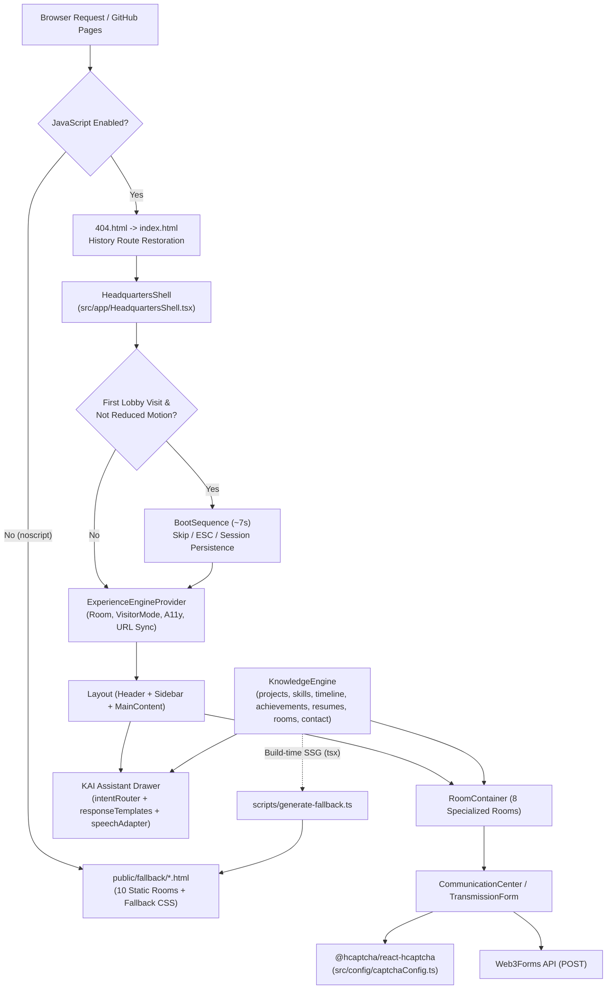

# KAI HQ — Kamalesh Artificial Intelligence Headquarters

[](https://github.com/Kamalesh-Suresh-Kumar/Portfolio-KAI-HQ/actions/workflows/deploy.yml)


> **Kamalesh Artificial Intelligence Headquarters (KAI HQ)** is an interactive, AI-inspired software engineering portfolio platform built by **Kamalesh Suresh Kumar**. It replaces the conventional scrolling resume page with an eight-room digital headquarters powered by a centralized Experience Engine, a typed Knowledge Engine, a deterministic client-side KAI Assistant, automated static fallback generation, and a Dockerized CI/CD pipeline.

---

## Live Experience

- **Production Deployment (GitHub Pages):** [https://kamalesh-suresh-kumar.github.io/Portfolio-KAI-HQ/](https://kamalesh-suresh-kumar.github.io/Portfolio-KAI-HQ/)
- **Source Repository:** [https://github.com/Kamalesh-Suresh-Kumar/Portfolio-KAI-HQ](https://github.com/Kamalesh-Suresh-Kumar/Portfolio-KAI-HQ)

> **System Notice:** KAI HQ is under active iterative development. Core rooms, search, role-tailored documents, static fallback pages, and automated verification suites are operational in production, while additional project case studies and interface refinements continue to roll out.

---

## Introduction & Philosophy

Standard developer portfolios flatten engineering work into a single linear page with minimal state, weak discoverability for recruiters versus technical reviewers, and no graceful degradation when scripts fail or are disabled.

KAI HQ models the portfolio as a structured **Headquarters Operating System**:

- **For Recruiters & Hiring Managers:** Switch to **Recruiter Mode** to surface concise role-fit summaries, verified credentials, and four role-tailored PDF resumes in the Document Vault.
- **For Engineers & Technical Reviewers:** Switch to **Developer Mode** to highlight architectural decisions, stacks, protocol engineering specimens, and system metrics in the Engineering Laboratory and Skill Processor.
- **For General Visitors:** Explore in **Neutral Mode** across eight specialized rooms, navigate via the spatial sidebar or `Cmd+K` / `Ctrl+K` Command Palette, or query the KAI Assistant directly.

---

## Core Features

- **Eight-Room Facility Architecture:** Clean path-based navigation across eight dedicated rooms (`Lobby`, `Engineering Laboratory`, `Memory Archive`, `Achievement Hall`, `Document Vault`, `Communication Center`, `Skill Processor`, and `Mission Control`) with entity-level deep links and GitHub Pages SPA route restoration (`public/404.html` + `index.html`).
- **Readable First-Visit Boot Sequence (~7 Seconds):** An interactive `KAI HQ // POWER-ON DIAGNOSTICS` terminal overlay (`BOOT_SEQUENCE_DURATION_MS = 7000`, completing at ~7.4 seconds with completion hold and exit transition) stepping through `NET_INIT`, `DATA_SYNC`, `FACILITY_MOUNT`, and `KAI_READY`. Supports single-action dismissal (`SKIP [ESC]` button, `Escape`, non-input `Space`/`Enter`, or backdrop click), `#main-content` focus restoration, 0ms `prefers-reduced-motion` bypass, direct deep-link bypass, and `sessionStorage` (`kai_hq_booted`) first-visit persistence.
- **Decoupled Experience & Knowledge Engines:** Central React Context (`ExperienceEngineProvider`) coordinating active room state, visitor perspective modes (`neutral`, `recruiter`, `developer`), assistant drawer state, voice output toggle, and motion preferences independently from the structured TypeScript knowledge store (`KnowledgeEngine`).
- **Interactive Lobby & AI Core Inspection:** Features an interactive AI Core portrait trigger opening an accessible `ProfilePhotoViewer` lightbox (`Escape` / backdrop / close dismissal and focus restoration), featured project and achievement highlights, visitor mode switcher, and active-development system banner.
- **Deterministic KAI Assistant:** Client-side floating assistant panel with natural language intent routing (`12` intents), typo/contraction normalization, mode-aware response templates, deep-link room action buttons, anti-spam rate limiting (`5` messages in `10s` -> `15s` cooldown), consecutive unknown-query cooldown (`5` -> `30s`), and optional Web Speech API voice input/output behind explicit privacy consent gates.
- **Global Search & Command Palette:** Full-text, mode-weighted search in Mission Control plus a global `Cmd+K` / `Ctrl+K` (`Alt+K` / `Meta+K` / button trigger) Command Palette with keyboard navigation across rooms, projects, skills, credentials, timeline milestones, and resumes.
- **Role-Tailored Resume Deliverables:** Four programmatic PDF resume variants (`Full-Stack`, `Backend`, `Cybersecurity`, `AI/Systems`) stored in `public/documents/` and downloadable from the Document Vault (`scripts/generate-resumes.ts`).
- **Protected Contact Transmission:** Web3Forms-backed contact form in the Communication Center protected by `@hcaptcha/react-hcaptcha`, client-side field validation, character bounds (`10–5000` chars), accessible custom/native-synced Subject selector, toast notifications, and input preservation on failure.
- **Zero-JavaScript Static Fallback System:** Automated static HTML generator (`scripts/generate-fallback.ts`) producing 10 standalone HTML/CSS pages mirroring all eight rooms using the exact same `KnowledgeEngine` data and shared `HCAPTCHA_CONFIG`, linked cleanly from `<noscript>` in `index.html`.

---

## Headquarters Facilities (8 Rooms)

| Code | Room Name | Production / Dev Route | Domain & Capabilities |
| :--- | :--- | :--- | :--- |
| `ROOM-01` | **Lobby** | `/` | Orientation hub, interactive AI Core portrait & lightbox viewer, Visitor Mode selector, featured projects & credentials, facility grid, and KAI Assistant entry banner. |
| `ROOM-02` | **Engineering Laboratory** | `/engineering-laboratory` | Filterable software & research specimens (`4` projects across `cybersecurity`, `fullstack`, `devops`, `ai-ml`), domain metrics, engineering decisions, and deep links (`/project/:id`). |
| `ROOM-03` | **Memory Archive** | `/memory-archive` | Chronological education, internship, naval cadetship, and technical society timeline (`5` milestones) with entity deep linking (`/timeline/:id`). |
| `ROOM-04` | **Achievement Hall** | `/achievement-hall` | Evidentiary gallery of law-enforcement briefings, certifications, and honors (`5` records) linked to underlying engineering projects (`/achievement/:id`). |
| `ROOM-05` | **Document Vault** | `/document-vault` | Role-tailored resume catalog (`4` downloadable PDF specs: Full-Stack, Backend, Cybersecurity, AI/Systems) and deep-link selection (`/resume/:id`). |
| `ROOM-06` | **Communication Center** | `/communication-center` | Web3Forms transmission console with hCaptcha verification, structured subject selection, validation, and external developer network coordinates. |
| `ROOM-07` | **Skill Processor** | `/skill-processor` | Categorized capability matrix (`20` skills across `5` domains, `4` discrete proficiency tiers) with accessible semantics and project cross-links (`/skill/:id`). |
| `ROOM-08` | **Mission Control** | `/mission-control` | Live Knowledge Engine search interface, `Cmd+K` / `Ctrl+K` Command Palette, portfolio telemetry counters, visitor mode switch, and facility directory. |

---

## KAI Assistant Architecture

KAI Assistant (`src/components/assistant/` & `src/assistant/`) is intentionally engineered as a **deterministic, zero-backend client-side conversational interface**—there are **no remote LLM API calls, no external vector databases, and no hidden API keys**.

1. **Query Normalization & Intent Routing (`src/assistant/intentRouter.ts`):**
   - Strips punctuation, expands contractions (`who's`, `what's`, `where's`, `how's`, `tell me`), and corrects common spelling variations (`projets` -> `projects`, `skils` -> `skills`, `experiance` -> `experience`, `achivement` -> `achievements`, `resum` -> `resume`, `contect` -> `contact`, `kamalsh` -> `kamalesh`).
   - Classifies input into `12` explicit `IntentType` values (`greeting`, `creator`, `about_kai`, `projects`, `skills`, `timeline`, `achievements`, `resumes`, `contact`, `room_navigation`, `help`, `unknown`) and resolves a `matchedRoom` when applicable.
2. **Mode-Aware Deterministic Response Templates (`src/assistant/responseTemplates.ts`):**
   - Pulls live entity counts, skills, projects, credentials, and resumes directly from `KnowledgeEngine` so assistant answers always stay synchronized with room content.
   - Adapts tone and emphasis dynamically based on the active `VisitorMode` (`neutral`, `recruiter`, `developer`) and attaches direct room navigation action chips and contextual quick-reply suggestions.
3. **Abuse & Rate-Limit Safeguards (`src/components/assistant/Assistant.tsx`):**
   - **Rate Limiting:** Sending `5` messages within a `10`-second sliding window triggers a `15`-second countdown cooldown.
   - **Unindexed Query Protection:** `5` consecutive `unknown` intents trigger a `30`-second cooldown with navigation recovery prompts.
4. **Voice Layer Privacy & Speech Adapter (`src/assistant/speechAdapter.ts`):**
   - Wraps browser-native `SpeechRecognition` (STT) and `SpeechSynthesis` (TTS) behind strict feature detection.
   - Sanitizes Markdown, decorative symbols, URLs, and code tokens (`cleanTextForSpeech`) before TTS playback, tracking active session tokens (`ActiveSpeechSession`) so `abortListening()` prevents stale late transcripts.
   - Enforces explicit user consent (`hasBrowserManagedConsent()` defaults to `false`) whenever speech recognition relies on browser-managed cloud processing rather than guaranteed local execution (`processLocally`), and deliberately avoids calling experimental `SpeechRecognition.install()`.

---

## System Architecture

KAI HQ separates **interaction state**, **domain data**, **UI presentation**, and **static delivery**:

- **Experience Engine (`src/experience-engine/`):** React Context (`ExperienceEngineProvider`) managing room transitions, History API URL synchronization (`buildPath`, `parsePath`, `resolveAssetUrl`), active visitor mode, assistant state, route focus/scroll management, screen-reader `aria-live` room announcements, and OS `prefers-reduced-motion` observation.
- **Knowledge Engine (`src/knowledge-engine/`):** Pure TypeScript singleton querying strongly typed data modules (`projects.ts`, `skills.ts`, `timeline.ts`, `achievements.ts`, `resumes.ts`, `rooms.ts`, `contact.ts`). Provides ID lookups, cross-reference resolution, and tokenized weighted `search(query, { mode })` across all portfolio entities.
- **Presentation & Feedback (`src/components/`, `src/rooms/`, `src/app/`):** Modular CSS custom-property design system layered on Tailwind CSS v4 (`@tailwindcss/vite`), WCAG AA-compliant contrast, skip-link focus targets (`#main-content`), and accessible custom widgets (`BootSequence`, `TransmissionForm`, `ProfilePhotoViewer`, `CommandPalette`).
- **GitHub Pages SPA Routing (`public/404.html` & `index.html`):** When a user loads a nested clean route such as `/Portfolio-KAI-HQ/engineering-laboratory` directly on GitHub Pages, `404.html` encodes the requested path and redirects cleanly to `/?p=...`, which `index.html` immediately restores via `window.history.replaceState` before React mounts.
- **Static Fallback Pipeline (`scripts/generate-fallback.ts`):** Reads directly from `KnowledgeEngine` and `HCAPTCHA_CONFIG` to emit zero-script static pages under `public/fallback/`, ensuring complete content parity and form accessibility when JavaScript is unavailable.

---

## Architecture Diagram

### Visual Repository Overview (GitDiagram)

[](https://gitdiagram.com/kamalesh-suresh-kumar/portfolio-kai-hq)

### Application Data & Runtime Flow



---

## Repository Structure

```text
Portfolio-KAI-HQ/
├── .github/workflows/
│   └── deploy.yml                   # Dockerized CI test, build, bundle check, E2E & GitHub Pages deploy
├── Docs/                            # Engineering SRS, Experience Design, Technical Design & Phase reports
│   ├── KAI-HQ-Volume-1-Vision-and-SRS.md
│   ├── KAI-HQ-Volume-2-Experience-Design.md
│   ├── KAI-HQ-Volume-3-Technical-Design.md
│   ├── KAI-HQ-Phase-4-Voice-and-Motion-Implementation.md
│   └── KAI-HQ-Phase-6-2-Fallback-Implementation.md
├── e2e/                             # Playwright end-to-end specifications
│   ├── accessibility-interaction.spec.ts
│   ├── helpers.ts
│   ├── javascript-disabled-fallback.spec.ts
│   ├── navigation.spec.ts
│   └── production-base-path.spec.ts
├── public/
│   ├── 404.html                     # GitHub Pages SPA sub-path gateway
│   ├── assets/                      # Brand SVGs and portrait media
│   ├── documents/                   # Generated PDF resumes (4 role-specific variants)
│   ├── fallback/                    # Generated zero-JS static HTML & CSS mirror (10 HTML + fallback.css)
│   ├── favicon.svg
│   └── icons.svg
├── scripts/                         # Verification suites & static generators
│   ├── check-bundle-budget.mjs      # Enforces <= 180 KB JS / <= 25 KB CSS gzip limits
│   ├── generate-fallback.ts         # Deterministic static HTML generator
│   ├── generate-resumes.ts          # PDFKit resume generator
│   ├── test-knowledge-engine.ts
│   ├── test-phase4-voice-motion.ts
│   ├── test-phase6-1-accessibility.ts
│   ├── test-phase6-2-fallback.ts
│   └── test-routing.ts
├── src/
│   ├── app/HeadquartersShell.tsx    # Top-level boot sequence & shell orchestrator
│   ├── assistant/                   # intentRouter.ts, responseTemplates.ts, speechAdapter.ts, types.ts
│   ├── components/
│   │   ├── assistant/               # Assistant drawer, input, message renderer, quick actions
│   │   ├── common/                  # NotificationToast
│   │   ├── dashboard/               # DashboardCard, SectionTitle, StatCard, StatusBadge
│   │   ├── layout/                  # Layout, MainContent, RoomContainer
│   │   ├── navigation/              # Header, Sidebar
│   │   └── system-feedback/         # BootSequence, bootConfig.ts, boot-sequence.css
│   ├── config/captchaConfig.ts      # Shared hCaptcha toggle & Web3Forms public site key
│   ├── experience-engine/           # Context provider, hook, routeHelper.ts, urlHelper.ts
│   ├── knowledge-engine/            # KnowledgeEngine.ts, types.ts & data/*
│   ├── rooms/                       # All 8 facility room implementations & styles
│   ├── styles/                      # Global design tokens, layout, spacing, typography & animations
│   ├── App.tsx
│   └── main.tsx
├── tests/                           # Vitest unit, parity & vitest-axe accessibility test suites
├── .dockerignore
├── .env.example                     # VITE_WEB3FORMS_ACCESS_KEY placeholder
├── Dockerfile.ci                    # Reproducible Node 24 + Playwright Chromium CI container
├── eslint.config.js
├── index.html                       # SPA entry point + <noscript> static fallback banner
├── package.json
├── package-lock.json
├── playwright.config.ts
├── tsconfig.json / tsconfig.app.json / tsconfig.node.json / tsconfig.test.json
├── vite.config.ts
└── vitest.config.ts
```

---

## Technology Stack

| Layer | Technology | Version (`package.json`) | Purpose |
| :--- | :--- | :--- | :--- |
| **UI Framework** | React & React DOM | `^19.2.7` | Component architecture, StrictMode rendering, state orchestration |
| **Language** | TypeScript | `~6.0.2` | End-to-end static typing across engines, UI, and tests |
| **Build Tool** | Vite & `@vitejs/plugin-react` | `^8.1.1` / `^6.0.3` | Fast bundling, manifest generation, environment base-path resolution |
| **Routing** | React Router DOM + custom `routeHelper` | `^7.18.1` | Clean room URLs and entity deep links |
| **Styling** | Tailwind CSS + `@tailwindcss/vite` | `^4.3.3` | Utility styling paired with CSS custom property themes |
| **Icons** | `lucide-react` & `react-icons` | `^1.26.0` / `^5.7.0` | Accessible crisp vector iconography |
| **Contact & Spam Defense** | `@hcaptcha/react-hcaptcha` + Web3Forms | `^2.2.0` | Bot mitigation and serverless form delivery |
| **PDF Generation** | `pdfkit` (`@types/pdfkit`) | `^0.20.2` (`^0.17.7`) | Programmatic generation of the 4 role-tailored resume PDFs |
| **Unit & A11y Testing** | Vitest, Testing Library, `jsdom`, `vitest-axe` | `^5.1.0` / `^16.2.0` / `^26.0.0` / `^0.1.0` | Component behavior, BootSequence timing, fallback parity, WCAG AA audits |
| **E2E Testing** | Playwright (`@playwright/test`) | `^1.65.0` | Chromium browser tests across live SPA and no-JS fallback routes |
| **Code Quality** | ESLint, `typescript-eslint`, Prettier | `^10.7.0` / `^8.62.0` / `^3.9.5` | Strict linting, React Hooks & React Refresh enforcement |
| **CI Runtime** | Docker (`node:24-bookworm`) + `tsx` | Node 24 (`tsx ^4.23.15`) | Reproducible CI execution (local dev tested on Node `v22.23.2`) |

---

## Getting Started

### Prerequisites

- **Node.js:** `22.x` or `24.x` (CI runs inside `node:24-bookworm`; local workspace verified on `v22.23.2`)
- **npm:** Included with Node.js (uses committed `package-lock.json` for deterministic `npm ci`)
- **Optional:** Docker (to replicate the exact CI container locally)

### Installation

```bash
git clone https://github.com/Kamalesh-Suresh-Kumar/Portfolio-KAI-HQ.git
cd Portfolio-KAI-HQ
npm ci
```

### Environment Configuration

Create a `.env.local` file from `.env.example` (never commit `.env.local` or real access keys):

```env
VITE_WEB3FORMS_ACCESS_KEY=your_web3forms_access_key
```

> **Note:** Local development runs cleanly even without a live Web3Forms key. The fallback generator injects `DEV_ACCESS_KEY_UNSET` in development mode unless `--production` is explicitly passed.

### Running Locally

```bash
# Start Vite dev server at http://localhost:3000
npm run dev

# Build static fallbacks, typecheck, and bundle production assets into dist/
npm run build

# Preview production dist/ locally at http://localhost:3000
npm run preview
```

### Regenerating Static Assets

```bash
# Regenerate all 4 PDF resumes in public/documents/
npm run generate:resumes

# Regenerate static zero-JS fallback pages in public/fallback/ (development safe mode)
npm run generate:fallback
```

---

## Available Commands

| Script | Underlying Command | Description |
| :--- | :--- | :--- |
| `npm run dev` | `vite --host 0.0.0.0 --port 3000` | Starts local development server on port 3000 |
| `npm run build` | `npm run generate:fallback && tsc -b && vite build` | Generates dev fallbacks, compiles TypeScript, and builds `dist/` |
| `npm run preview` | `vite preview --host 0.0.0.0 --port 3000` | Serves the built `dist/` bundle locally |
| `npm run lint` | `eslint .` | Runs ESLint across TypeScript, React, and test files |
| `npm run typecheck` | `tsc -b && tsc -p tsconfig.test.json --noEmit` | Verifies application and test TypeScript configurations |
| `npm run check:bundle` | `node scripts/check-bundle-budget.mjs` | Enforces JS (`<= 180 KB` gzip) and CSS (`<= 25 KB` gzip) budgets |
| `npm run generate:resumes` | `tsx scripts/generate-resumes.ts` | Generates all 4 PDF resumes via `pdfkit` |
| `npm run generate:fallback` | `tsx scripts/generate-fallback.ts` | Generates 10 zero-JS static HTML fallback pages |
| `npm run test:knowledge` | `tsx scripts/test-knowledge-engine.ts` | Knowledge Engine integrity, search ranking & PDF asset checks (`31` assertions) |
| `npm run test:routing` | `tsx scripts/test-routing.ts` | Dev & `/Portfolio-KAI-HQ/` base-path routing & entity resolution (`34` assertions) |
| `npm run test:phase4` | `tsx scripts/test-phase4-voice-motion.ts` | Assistant intent, voice privacy, boot timing & regression suite |
| `npm run test:phase6-1` | `tsx scripts/test-phase6-1-accessibility.ts` | Skip link, focus restoration, route announcer & proficiency checks |
| `npm run test:phase6-2` | `tsx scripts/test-phase6-2-fallback.ts` | Static fallback structure, idempotence & `<noscript>` checks (`330` assertions) |
| `npm run test:parity` | `vitest run tests/fallback-parity.test.ts` | Data parity between `KnowledgeEngine` and static HTML pages (`34` tests) |
| `npm run test:fallback-a11y` | `vitest run tests/fallback-accessibility.test.ts` | `vitest-axe` WCAG AA audit across all static fallback pages (`20` tests) |
| `npm run test:unit` | `vitest run` | Runs all `6` Vitest suites (`116` tests total) |
| `npm run test:all` | Chains `knowledge`, `routing`, `phase4`, `phase6-1`, `phase6-2`, `unit` | Master pre-build verification gate |
| `npm run test:e2e` | `playwright test` | Runs Playwright Chromium E2E tests (`test:e2e:headed` / `test:e2e:ui` available) |

---

## Testing & Quality Assurance

Every commit is validated by a multi-layered test architecture spanning static analysis, domain-script verification, Vitest unit/accessibility suites, and Playwright E2E coverage:

| Suite / Gate | Scope | Verified Result |
| :--- | :--- | :--- |
| **ESLint (`npm run lint`)** | TypeScript, React Hooks, React Refresh rules | `0` errors |
| **TypeScript (`npm run typecheck`)** | App (`tsconfig.b`) + Test suite (`tsconfig.test.json`) | `0` errors |
| **Knowledge Engine Audit (`test:knowledge`)** | ID uniqueness, cross-links, weighted search, 4 PDF files on disk | `31 passed, 0 failed` |
| **Routing Audit (`test:routing`)** | All 8 rooms in dev & `/Portfolio-KAI-HQ/`, entity deep links, fallback routes | `34 passed, 0 failed` |
| **Voice, Motion & Boot (`test:phase4`)** | 12 assistant intents, TTS sanitization, STT consent/abort, 7000ms boot constraints | All assertions passed |
| **Keyboard & A11y (`test:phase6-1`)** | `#main-content` skip link, assistant/drawer focus return, route announcer, skill tiers | All assertions passed |
| **Static Fallback Suite (`test:phase6-2`)** | 10 HTML pages, zero body scripts, hCaptcha/Web3Forms parity, deterministic rebuild | `330 passed, 0 failed` |
| **Vitest Unit & Axe (`test:unit`)** | `6` test files (`boot-sequence`, `captcha`, `fallback-accessibility`, `fallback-parity`, `features-enhancement`, `infrastructure`) | `116 passed` across `6` files |
| **Playwright E2E (`e2e/*.spec.ts`)** | Navigation, production base path, keyboard/reduced-motion, JS-disabled fallback | Executed in Docker CI (`Dockerfile.ci` with Chromium) |

---

## Docker-Based CI/CD Architecture

KAI HQ uses a containerized GitHub Actions workflow (`.github/workflows/deploy.yml` + `Dockerfile.ci`) to eliminate host-environment drift between local builds and CI runners:

1. **Trigger & Concurrency:** Runs on `push` and `pull_request` targeting `main`, canceling superseded PR runs while preserving sequential production deployments.
2. **Pre-Flight Secret Guard:** On `push` to `main`, verifies `secrets.VITE_WEB3FORMS_ACCESS_KEY` is present before building. (Pull requests use an isolated dummy CI validation token so PR checks remain safe without exposing secrets.)
3. **Container Image (`Dockerfile.ci`):** Builds on `node:24-bookworm`, runs `npm ci --include=optional`, and pre-installs Playwright Chromium (`npx playwright install --with-deps chromium`).
4. **Full Verification Inside Container:**
   - `npm run lint` -> `npm run typecheck` -> `npm run test:all`
   - `npm run generate:fallback -- --production` (embeds production Web3Forms key strictly in CI artifact)
   - `npx tsc -b && npx vite build` (with `GITHUB_ACTIONS=true`, setting `/Portfolio-KAI-HQ/` base path)
   - `npm run check:bundle` (hard gate on JS/CSS gzip sizes)
   - `npm run test:e2e` (Playwright Chromium suite against built `dist/`)
5. **Artifact Publication & Deployment:** Uploads `./dist` via `actions/upload-pages-artifact` and deploys to the `github-pages` environment via `actions/deploy-pages` exclusively on `push` to `main`.

---

## Performance Budget & Optimization

`scripts/check-bundle-budget.mjs` enforces the **Volume 3 §11.3 Performance Budget** against Vite's production manifest (`dist/.vite/manifest.json`) on every build:

- **Initial Critical-Path JavaScript Budget:** `<= 180.00 KB` gzip (`180,000 B`)
- **Total CSS Budget:** `<= 25.00 KB` gzip (`25,000 B`)
- **Measured Production Output (Current Verified Build):**
  - **Entry JavaScript (`dist/assets/index-*.js`):** `477.65 KB` raw | **`134.27 KB` gzip** (`74.6%` of budget utilized, **`+45.73 KB` headroom**)
  - **Production CSS (`dist/assets/index-*.css`):** `118.98 KB` raw | **`17.48 KB` gzip** (`69.9%` of budget utilized, **`+7.51 KB` headroom**)
- **Optimization Approach:** Per **ADR-04**, heavy 3D/runtime animation dependencies (Three.js, GSAP, Framer Motion) were deliberately excluded (`0 KB` motion dependency overhead) in favor of pure CSS transitions and lightweight `requestAnimationFrame` progress timing.
- **Transparency Note on Chunking:** All eight facility rooms currently ship within a single monolithic entry JavaScript bundle while remaining well under the 180 KB gzip ceiling; route-level `React.lazy` code splitting is preserved as a future optimization path.

---

## Security & Privacy

- **Zero Exposed Personal Secrets:** No personal email addresses, phone numbers, messaging handles, or private API keys are committed to the repository or documentation. `.env.local` is gitignored, and `.env.example` contains only an empty variable declaration.
- **Dev vs. Production Access Key Guard (`scripts/generate-fallback.ts`):** Development fallback generation (`npm run generate:fallback`) always emits `DEV_ACCESS_KEY_UNSET` even if `.env.local` exists locally. Passing `--production` strictly rejects missing or placeholder keys so real keys only enter built CI artifacts at deploy time, while recognizing that any `VITE_*` key compiled for static client submission to Web3Forms is inherently a public client submission token.
- **Spam & Abuse Defense (`src/config/captchaConfig.ts` & Web3Forms):** `HCAPTCHA_CONFIG.enabled` is active (`true`), requiring verified `h-captcha-response` tokens on both the React `TransmissionForm` and the static fallback form, backed server-side by Web3Forms **Advanced Spam Filter** and **Strict** spam protection policies.
- **Zero Telemetry & Zero Backend Tracking:** KAI HQ runs without analytics trackers, external databases, or server-side session logging. Assistant queries remain strictly in-memory inside the browser tab, and Web Speech recognition respects explicit user consent (`speechAdapter.ts`).

---

## Accessibility

KAI HQ targets **WCAG 2.1 Level AA** compliance across both the interactive React shell and static fallback output:

- **Skip Navigation & Focus Management:** First-tab `"Skip to main content"` link targets `#main-content` (`tabIndex={-1}`), room changes manage heading/container focus cleanly, and dialogs (`BootSequence`, `Assistant`, `ProfilePhotoViewer`, mobile drawer, `CommandPalette`) restore focus to originating triggers on close.
- **Screen-Reader Navigation Announcements:** Centralized `#kai-route-announcer` (`aria-live="polite"`) announces room transitions without emitting duplicate announcements on initial mount or same-room updates.
- **Keyboard Operability & Input Protection:** `Cmd+K` / `Ctrl+K` Command Palette, arrow-key accessible Subject selector in `TransmissionForm`, `Escape` dismissal across modals, and input-focus guards preventing `Space`/`Enter` inside text fields from dismissing overlays prematurely.
- **Reduced Motion Compliance:** Detects OS `(prefers-reduced-motion: reduce)` globally, bypassing the 7-second `BootSequence` in `0ms` and flattening transition/animation durations.
- **Automated Axe Verification:** `tests/fallback-accessibility.test.ts` validates zero `vitest-axe` violations across every generated static HTML fallback page.

---

## Static Fallback System

If JavaScript is disabled, blocked, or fails to hydrate:

1. `index.html` renders a styled `<noscript>` gateway providing direct relative links (`./fallback/*.html`, safe under both `/` and `/Portfolio-KAI-HQ/`) to all eight facility rooms.
2. `scripts/generate-fallback.ts` generates **10 pure static HTML files** (`index.html`, `lobby.html`, `engineering-laboratory.html`, `memory-archive.html`, `achievement-hall.html`, `document-vault.html`, `communication-center.html`, `skill-processor.html`, `mission-control.html`, plus shared `fallback.css`) containing zero inline `<script>` tags inside room bodies, full Knowledge Engine data parity, resume PDF download links, and Web3Forms/hCaptcha status handling (`Phase 6.2`).
3. Every build verifies deterministic byte-for-byte re-generation and runs `fallback-parity.test.ts` (`34` tests) + `fallback-accessibility.test.ts` (`20` tests).

---

## Engineering Documentation

Complete architectural specifications and phase implementation reports live in [`./Docs`](./Docs):

- [**Volume 1 — Vision & Software Requirements Specification (SRS)**](./Docs/KAI-HQ-Volume-1-Vision-and-SRS.md)
- [**Volume 2 — Experience Design Specification**](./Docs/KAI-HQ-Volume-2-Experience-Design.md)
- [**Volume 3 — Technical Design & Architecture Specification**](./Docs/KAI-HQ-Volume-3-Technical-Design.md)
- [**Phase 4 — Voice, Motion & Boot Timing Implementation**](./Docs/KAI-HQ-Phase-4-Voice-and-Motion-Implementation.md)
- [**Phase 6.2 — Static No-JS Fallback Implementation**](./Docs/KAI-HQ-Phase-6-2-Fallback-Implementation.md)

---

## Acknowledgements & Special Thanks

### Special Thanks

- [Monisha A](https://github.com/Monishaappavu)
- [Kasilingam M](https://github.com/lingaa005)

### Acknowledgements

This repository originally evolved from an experimental sample portfolio created with guidance, inspiration, and reference from the following open-source projects:

- [Monisha's Portfolio](https://github.com/Monishaappavu/portfolio_2025)
- [Lingaa's Flask Email Server](https://github.com/lingaa005/lingaaflask.git)

### Historical Note

The Flask email server developed by Kasilingam Maruthamuthu (Lingaa) was used only in the local development environment during the early stages of this project. It is **not included** in this repository, as the architecture was redesigned into a purely static, client-first portfolio platform powered by Web3Forms and hCaptcha. Proper credit remains preserved for the original work and inspiration.

> *End of Sample Portfolio — Evolution into Kamalesh Artificial Intelligence Headquarters (KAI HQ).*

---

## Roadmap & Future Enhancements

Planned enhancements tracked beyond the current production baseline:

- **Optional LLM Provider Adapter:** Connect an optional external or edge LLM behind the existing `routeIntent()` / `KnowledgeEngine` interface seam while retaining sub-10ms deterministic local fallback.
- **Route-Level Code Splitting:** Introduce `React.lazy` dynamic chunks for secondary facility rooms once bundle growth approaches the 180 KB gzip ceiling.
- **Expanded Specimen & Research Archive:** Add new engineering case studies, security advisories, and live architectural walkthroughs as active projects graduate.
- **Continuous Accessibility & Visual Regression Hardening:** Expand Playwright visual and keyboard regression coverage across emerging room interactions.

---

## License

No dedicated `LICENSE` file is currently present in the repository root. Unless an explicit open-source license is added by the author, all code, design systems, and original written materials remain copyright **Kamalesh Suresh Kumar** (`All Rights Reserved`).
